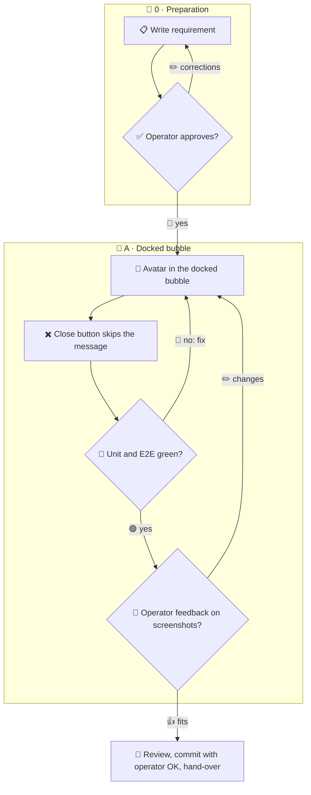

# 098 - Docked Speech Bubbles with Avatar and Close

## User Story

As the operator, I want a speech bubble that sits at the bottom screen edge
to show who speaks by their avatar and to close with one click, so that I
know the speaker without an avatar on screen and can skip a message I do not
need.

## Decisions (operator-confirmed 2026-11-28; do not re-litigate)

1. **Avatar inside the docked bubble**: a bubble that has no visible avatar
   to point at sits in the bottom bar (`.bubble-bar`); there it shows the
   speaker's avatar (the same `face()` as everywhere in the hub) on the left,
   next to the name. A bubble anchored to an avatar keeps its tail and shows
   neither the avatar nor the close icon. Rejected: avatar only without close;
   a chat dock with history; a mini avatar in the top bar as anchor.
2. **Close icon on every docked bubble**: a visible × button (not only on
   hover, so touch works), keyboard reachable, with a tooltip naming what it
   does. Rejected: × on hover only; one × for the whole bar.
3. **× skips the message**: on the bubble being read aloud the voice stops
   that message and goes on with the next; a silent bubble leaves with the
   usual fade (086); a queued one leaves the queue. Rejected: hide the bubble
   while the voice reads on; stop all speech.
4. **Own requirement**: 052 (bubbles beside modes) stays as it is.

## Approach

## Acceptance Criteria

### Avatar

- [ ] A bubble in `.bubble-bar` shows the speaker's `.avatar[data-face]`
      left of the name.
- [ ] A bubble anchored to an avatar shows no avatar and no close button.
- [ ] The avatar inside a bubble is never used as an anchor for a bubble.

### Close

- [ ] Every docked bubble has a `button` with an accessible name and a
      tooltip; it takes clicks although the bubble layer ignores the pointer.
- [ ] A click on × of the message being read aloud stops its audio, and the
      next pending message starts.
- [ ] A click on × of a silent bubble removes it through `vanish()`, and it
      does not come back on the next poll.
- [ ] A click on × of a queued message removes it from the queue.

### Tests

- Unit:
  - [ ] The skip of the current, a queued and a silent item (node).
- Integration:
  - n/a: no server change.
- E2E:
  - [ ] `tests/e2e/test_bubble_dock_e2e.py`: a docked bubble shows avatar
        and ×, an anchored one neither, × removes the silent bubble.
