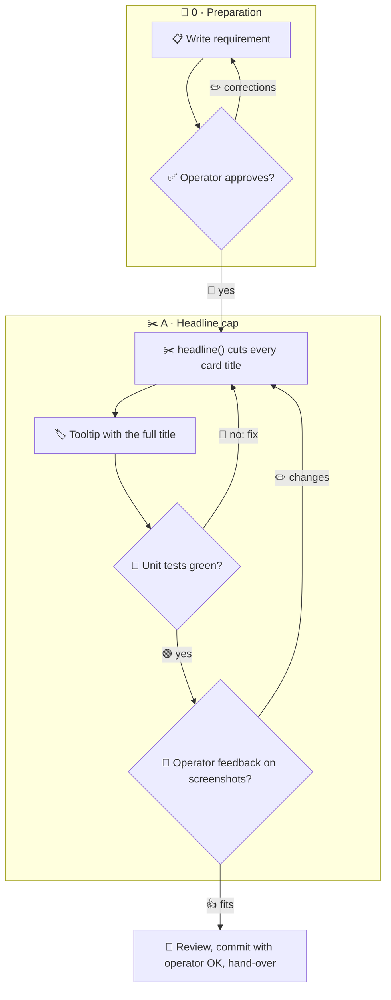

# 099 - Match Card Headline Capped at 120 Characters

## User Story

As the operator, I want a Match card's headline cut to a fixed length while
its code box keeps the whole command, so that a long command does not fill
the card before I see its place, kind and buttons.

## Decisions (operator-confirmed 2026-11-28; do not re-litigate)

1. **Cut on the hub**: every Match card's `title` is at most 120 characters,
   cut at the last word boundary before the limit and ended with "…"; the
   headline, the peek row, the release card row, the reject sheet and every
   toast use it. Rejected: a heuristic summary (program, subcommand, first
   argument); a CSS line-clamp that leaves toasts and the release card long.
2. **Whole text stays**: the code box keeps the full `command`, and the
   headline's tooltip names the full title when it was cut.
3. **Binding unchanged**: the card hash is computed from the uncut title and
   command, so cutting changes no signature and no stale check.

## Approach

## Acceptance Criteria

### Cap

- [ ] A command card whose command has 900 characters carries a `title` of
      at most 120 characters ending in "…" and its full `command`.
- [ ] A title of 120 characters or fewer stays unchanged.
- [ ] A word longer than the limit is cut inside the word.
- [ ] The card hash of a long command is the same as before the cap.

### Page

- [ ] The headline of a cut card has a tooltip with the full title.

### Tests

- Unit:
  - [ ] `headline()` on short, long, single-word and exact-limit titles.
- Integration:
  - [ ] A command card from the hub's Match view carries the cut title and
        the full command.
- E2E:
  - n/a: the existing Match E2E specs render the cut title; no new spec.
