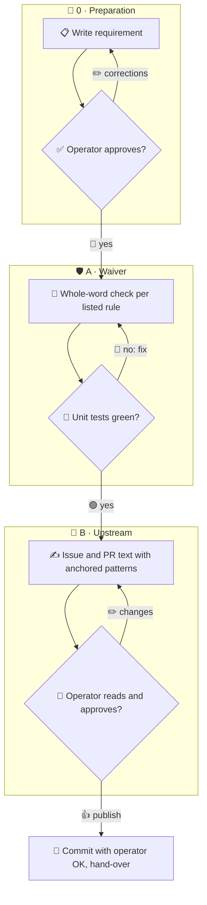

# 100 - MEDUSA Regex False Positives Waived and Reported Upstream

## User Story

As the operator, I want the MEDUSA rules whose unanchored regexes match
everyday words waived in `kvb-check-security` and reported upstream, so
that a commit no longer needs dozens of accept rows for code that has
nothing to do with the attacks those rules describe.

## Decisions (operator-confirmed 2026-11-28; do not re-litigate)

1. **Waiver in kvb-check-security**: `security.py` drops findings of a
   listed rule when the matched line does not hold the rule's word as a
   whole word (`\bPLA\b`, `\bELS\b`); the list starts with
   `MEDUSA-MM-SCAN-058` (pattern `PLA`, hits replay, place, plan,
   replace) and `MEDUSA-WM-SCAN-354` (pattern `(?i)ELS`, hits else). A
   finding whose line holds the whole word still counts. Rejected: keep
   accept rows per line (62 rows on 2026-11-28, Quality hit 42 in one
   file).
2. **Upstream report**: an issue, and a pull request with anchored
   patterns and a test, to the MEDUSA repository, written by the
   kvb-release style rules; it publishes only after the operator reads
   the text.
3. **Accept rows stay valid**: the existing rows keep working; the waiver
   only removes the need for new ones.
4. **Build after the restart of 2026-11-28**, not before.

## Approach

## Acceptance Criteria

### Waiver

- [ ] A MM-SCAN-058 finding on `errors="replace"` is dropped from the score.
- [ ] A MM-SCAN-058 finding on a line naming `PLA` as a word still counts.
- [ ] A WM-SCAN-354 finding on `x if y else code()` is dropped.
- [ ] Existing accept rows still remove their findings.

### Upstream

- [ ] The issue and PR text name both patterns, the false hits and the
      anchored replacement, and the operator approved them before sending.

### Tests

- Unit:
  - [ ] Waived, counted and accepted findings for both rules.
- Integration:
  - [ ] `security.py --base HEAD` over a fixture repository with
        `errors="replace"` reports 100 % without an accept row.
- E2E:
  - n/a: no page.
