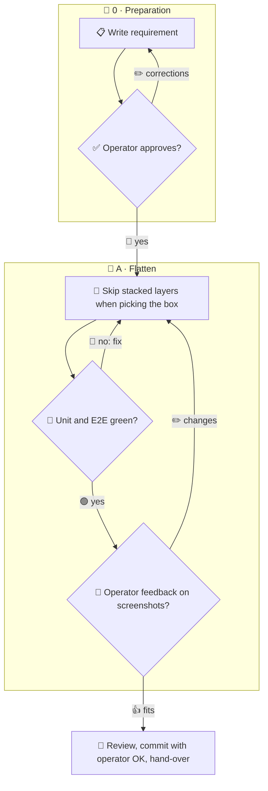

# 101 - Home Tile Flatten Skips the Match Card Pile

## User Story

As the operator, I want the Match card in a Home tile to look like the
card on the Match page, so that the widget shows the card itself instead
of a stripped pile layer.

## Decisions (operator-confirmed 2026-11-28; do not re-litigate)

1. **Flatten skips stacked decoration**: 044's flatten in `page-home.js`
   picks the first box with its own border or background as the tile's
   box; it now skips absolutely positioned or `aria-hidden` layers (the
   Match pile layers behind the front card), so the front card's own
   wrapper becomes the box. Rejected: a Match-only exception in the
   flatten; leaving the layer stripped.
2. **Other tiles unchanged**: every tile whose box 044 flattened today
   keeps the same box.
3. **Build after the restart of 2026-11-28**.

## Approach

## Acceptance Criteria

### Flatten

- [ ] In the Match Home tile no element with `.match-pile` (or another
      absolutely positioned or `aria-hidden` layer) carries `.home-flat`.
- [ ] The Match tile's front card keeps its border and background.
- [ ] Every other tile of `tests/e2e/test_home_flat_widgets_e2e.py` keeps
      its flattened box.

### Tests

- Unit:
  - [ ] The box pick skips an absolutely positioned and an `aria-hidden`
        layer (node).
- Integration:
  - n/a: no server change.
- E2E:
  - [ ] `tests/e2e/test_home_flat_widgets_e2e.py` gains the Match tile.
